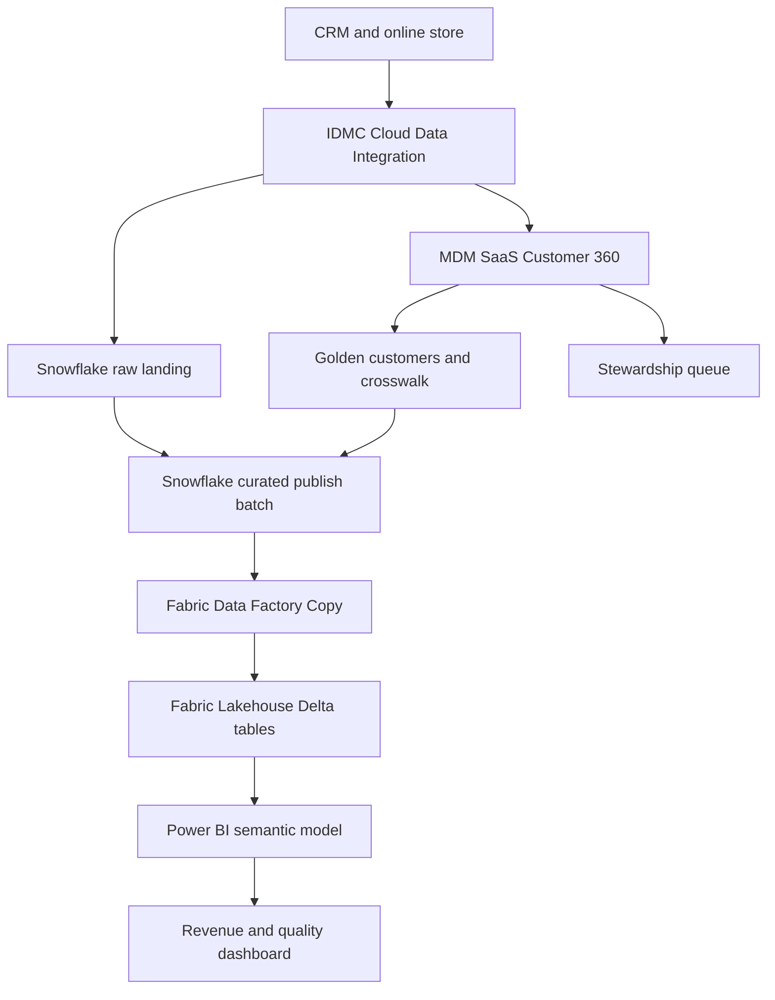

# Customer 360: Informatica IDMC + MDM + Snowflake + Microsoft Fabric + Power BI

An integrated enterprise portfolio project: trusted customer identities, governed orders, and consistent revenue reporting across systems.

**Status:** runnable local reference implementation with synthetic data. Native cloud setup guides, SQL, PySpark and DAX starters are provided; they have NOT been executed in licensed vendor environments. The Python matching rules simulate a narrow MDM use case; they are not Informatica software or a replacement for its match engine. No cloud deployment or performance improvement is claimed.

## Business problem
A retailer has CRM and online-store customer records. One customer can appear twice, shared email addresses can belong to different people, and orders can refer to unresolved customers. Reports must count mastered customers and exclude unresolved orders from certified revenue while exposing exceptions for stewardship.

## Architecture


MDM in this design means **Informatica MDM SaaS / Business 360**, not an installed Multidomain MDM Hub. Azure hosts the proposed Snowflake account and Fabric environment. ADF is an optional ingestion alternative; duplicating orchestration is intentionally unnecessary.

## Run now — no cloud account required
Python 3.10+; standard library only. From this folder:
```sh
python -m unittest discover -s tests -v
python src/pipeline.py
python src/pipeline.py
```
First run: **2 golden customers, 3 accepted orders, 6 rejected rows, USD 200.00 accepted revenue**. Rejected rows comprise 3 customers and 3 orders; they are not 6 rejected orders. Second run reports `replay_skipped`. CSV exports are in `output/exports/`; SQLite is `output/demo.db`. Use a new `--db` path for a fresh demo.

## What is implemented
- Trusted loyalty-ID matching, normalized-email conflict detection and CRM-first record survivorship.
- Source-to-golden customer crosswalk; ambiguous records sent to an exception queue.
- Currency/amount validation, orphan rejection, source-key conflict checks and exact duplicate handling.
- Transactional full-snapshot replacement, content fingerprint, replay protection and audit totals.
- CSV exports for a local Power BI Import demonstration, automated tests and CI workflow.

This version is a **complete-snapshot pipeline**, not CDC. Submit snapshots in order. The ledger blocks replay of committed batch IDs but does not identify an old snapshot submitted under a new ID. Empty/partial input can replace current data: production requires completeness manifests and an approval gate for unusual volume drops. Trusted-ID corrections, unmerge, SCD2, currency conversion and multi-table atomic cloud publication remain extensions. See [design decisions](docs/architecture.md).

## Repository map
| Folder | Contents |
|---|---|
| `src/` | Executable local mastering, validation, load and export |
| `tests/` | Failure, identity, reconciliation and replay tests |
| `data/` | Entirely synthetic customers and orders |
| `cloud/` | Snowflake SQL, Fabric PySpark, Power BI DAX and IDMC/MDM build specifications |
| `docs/` | Architecture, deployment, dashboard, troubleshooting and interview guide |
| `evidence/` | Captured local test and demo output |

Start with [deployment](docs/deployment.md), then [IDMC and MDM setup](cloud/idmc-mdm-build.md), [Power BI demonstration](docs/powerbi-demo.md), and [interview walkthrough](docs/interview.md).

## Evidence and honest portfolio use
See [test output](evidence/tests.txt) and [demo output](evidence/demo.txt). Cloud execution evidence is pending. A verified resume bullet may state: “Built and tested a synthetic Customer 360 reference pipeline with identity crosswalks, conflict quarantine, transactional snapshot loading and replay protection; documented its IDMC, MDM, Snowflake, Fabric and Power BI deployment design.” Do not describe this as a production cloud implementation.

## Prerequisites and costs
Local Python/SQLite costs no vendor subscription. Power BI Desktop can consume the CSV demo on Windows. IDMC CDI connector entitlements, a supported runtime, and MDM SaaS entitlement are needed for the native path; an IDMC account alone does not establish MDM access. Snowflake compute/storage, Azure staging storage if used, Fabric capacity and Power BI sharing licenses can incur charges. Trials depend on account eligibility. No cloud resources are provisioned by running this repository. Start small, configure budgets and suspend unused Snowflake warehouses.

[Primary vendor references](docs/references.md). No client data, real customer identities, secrets or proprietary exports are included.
